<div align="center">

# 🍛 RestoPro ERP

**The back office of a small restaurant, in one place.**<br>
Daily sales, expenses and vendor khata, staff attendance and salary ledger, reports, and cloud backups.<br>
Built for Indian restaurants, dhabas, cafés and sweet shops. Runs on cheap shared hosting.

[](https://laravel.com)
[](https://livewire.laravel.com)
[](https://tailwindcss.com)
[](https://www.php.net)
[](#-requirements)
[](#-tests)
[](LICENSE)

[Features](#-features) · [Screenshots](#-screenshots) · [Quick start](#-quick-start) · [Setup guide](docs/SETUP.md) · [API](docs/API.md) · [Backups](docs/BACKUP_SETUP.md)

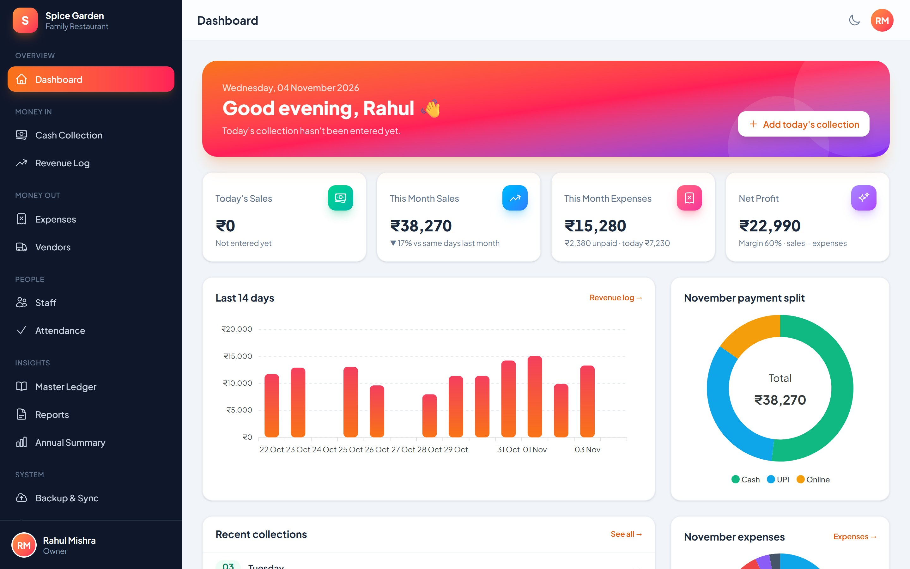

</div>

---

## ✨ Features

<table>
<tr>
<td width="50%" valign="top">

### 💰 Money in
- **Cash collection.** One entry per day split into **Cash · UPI · Online**. Reminds you about missed days.
- **Revenue log.** Presets for today, week, month and **financial year**. Group by day, week or month. Trend and payment-mode charts, CSV export.

### 🧾 Money out
- **Expenses.** Categories (Milk, Gas, Grocery, Vegetable, Koila…) with colours. **Paid, partly paid or unpaid**, payment mode, and a **bill photo** from your phone camera.
- **Vendors and khata.** Opening balance, running statement, payments **settled FIFO** against the oldest bills, advance tracking, and the balance sent on **WhatsApp** in one tap.

</td>
<td width="50%" valign="top">

### 👥 People
- **Staff.** Monthly salary or daily wage, photo, ID and emergency contact.
- **Attendance register.** Present, half day, absent, paid leave or week off. Tap to cycle, or mark everyone present at once.
- **Salary ledger with carry-forward.** Salary, advance, bonus and deduction. Month-by-month opening → work value → paid → closing, plus **full-year work value and total paid**.
- **Share link for staff** (no login, optional 4-digit PIN). Each person sees their own attendance, payments and balance.

### 📊 Insights
- **Master ledger.** Every rupee in and out, with **cash / bank-UPI / online** account balances.
- **Reports.** Monthly P&L, yearly, sales, expenses, vendor dues and salary sheet. Download as **PDF** or **Excel**.
- **Annual summary.** Charts with like-for-like **▲▼ vs last year**, best and slowest days, and expense mix.

</td>
</tr>
<tr>
<td valign="top">

### ☁️ Backup and sync
- One-click **ZIP backup** (data + bill photos, checksummed) and a **daily automatic backup**.
- Upload to **Google Drive**, **Dropbox** or a **private GitHub repo**.
- **Restore** with preview and a safety copy taken first. Works across databases (SQLite ⇄ MySQL).

</td>
<td valign="top">

### 🔐 Access and settings
- Sign in with **mobile number, username or email**. Profile with photo. Dark mode.
- **Owner and manager** roles. Managers enter data but can't delete, back up or change settings.
- **Settings.** Business name, **logo**, address, GSTIN and FSSAI number on every PDF. Financial-year start month.
- **REST API** with device tokens, which the Android app uses.

</td>
</tr>
</table>

> 🇮🇳 Indian number grouping (₹1,00,000), April–March financial year by default, Asia/Kolkata time zone. Both the year start and the currency symbol can be changed.

## 📸 Screenshots

| | |
|:---:|:---:|
| 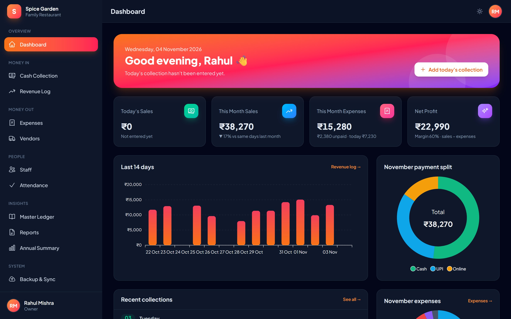<br>**Dark mode** | 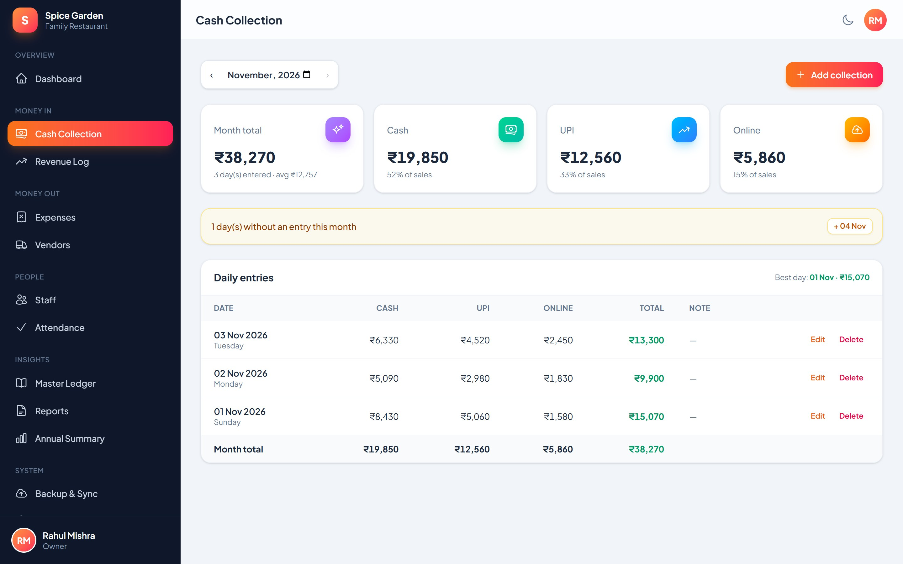<br>**Cash collection** |
| 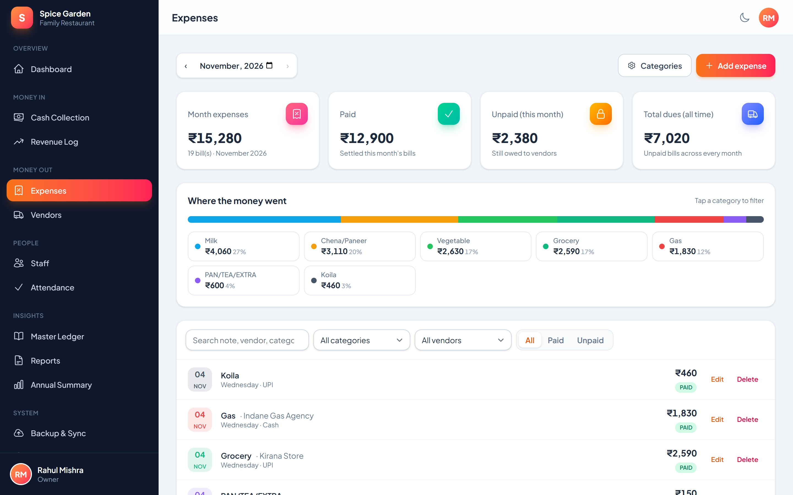<br>**Expenses with bill photos** | 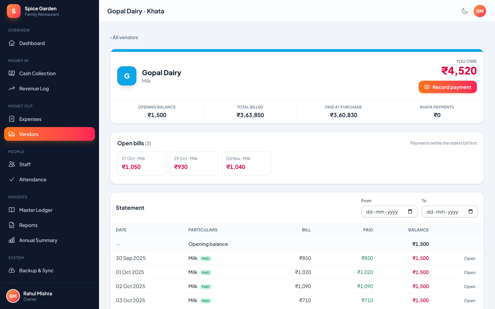<br>**Vendor khata (FIFO settlement)** |
| 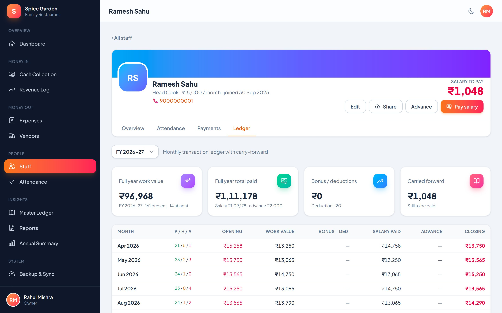<br>**Staff ledger with carry-forward** | 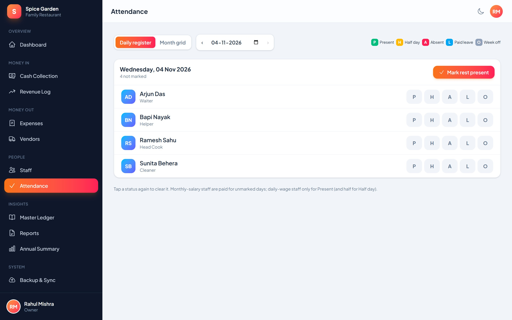<br>**Attendance register** |
| 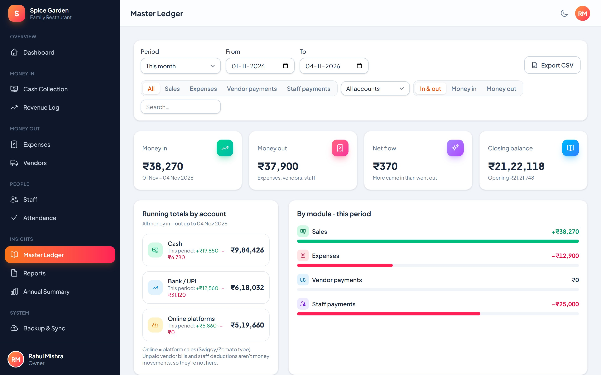<br>**Master ledger** | 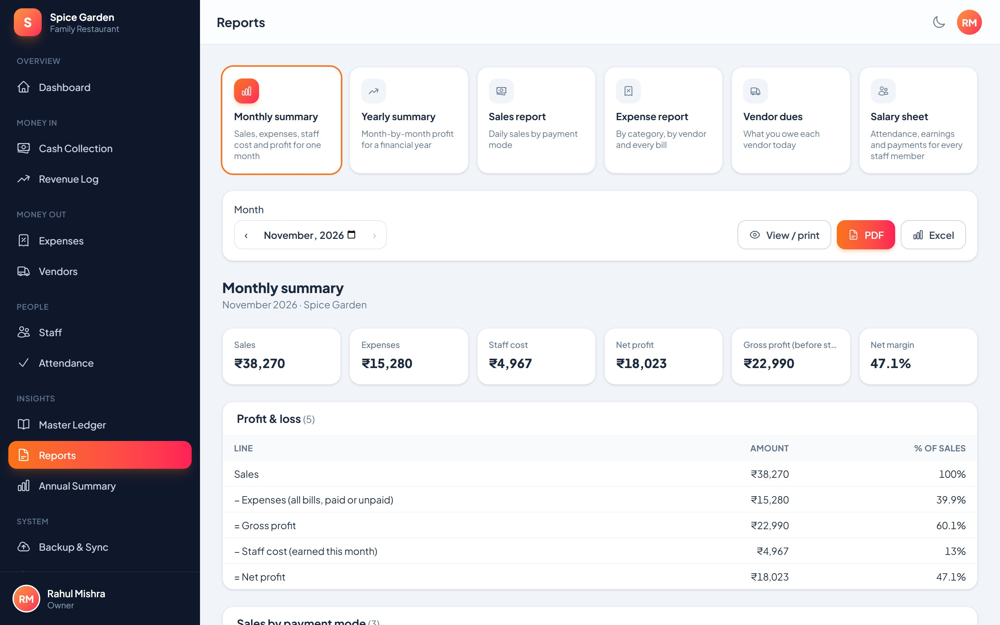<br>**Reports → PDF / Excel** |
| 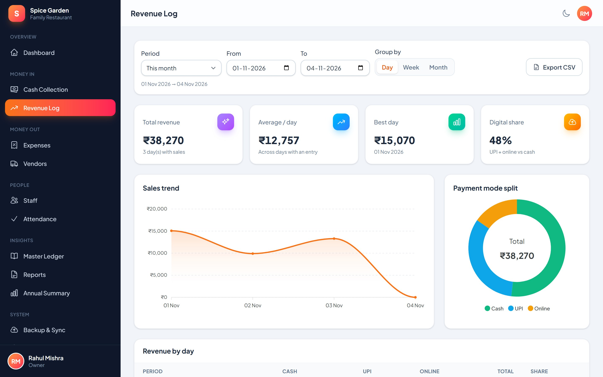<br>**Revenue log** | 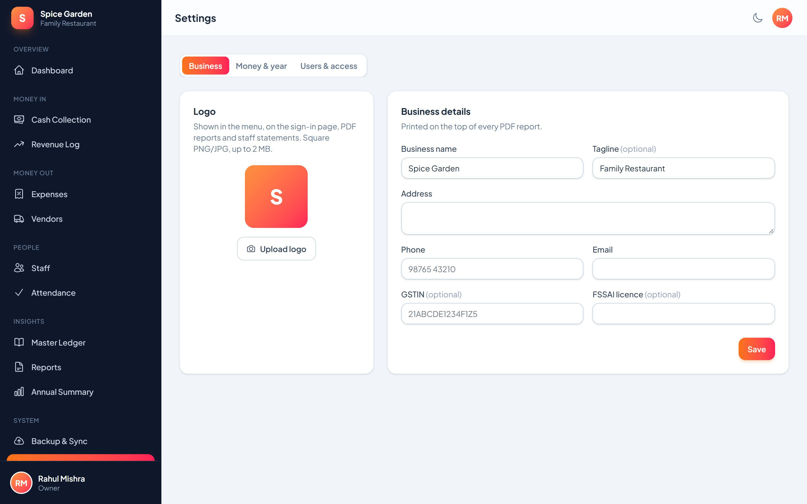<br>**Settings** |

<details>
<summary><b>📈 Annual summary (full page)</b></summary>
<br>
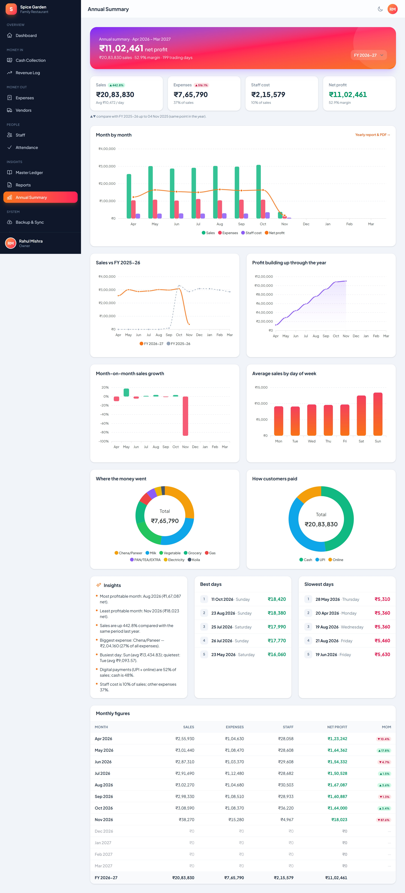
</details>

<p align="center">
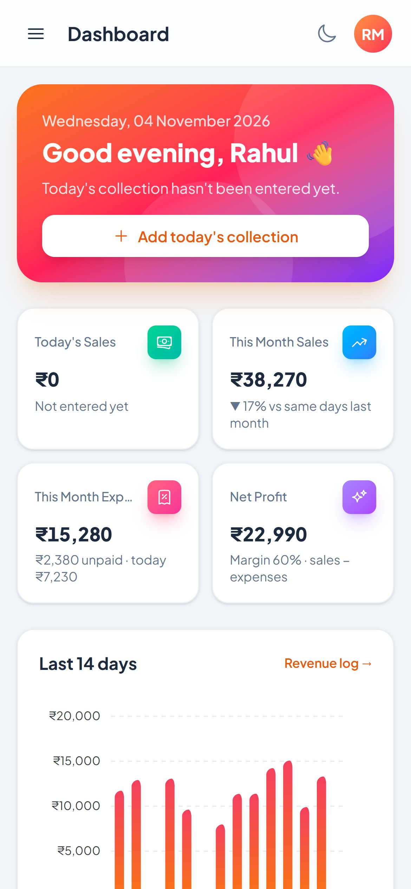&nbsp;
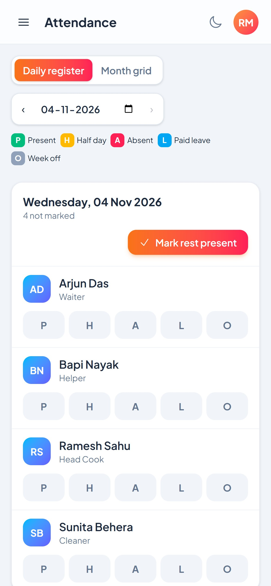&nbsp;
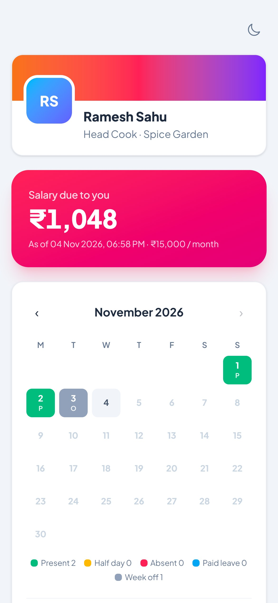<br>
<sub>Fully responsive: dashboard · attendance · the staff's own share page</sub>
</p>

<sub>All screenshots use made-up demo data (`DemoSeeder`).</sub>

## 🚀 Quick start

You need **PHP 8.2+** (with `sqlite3`, `mbstring`, `gd`, `zip`, `intl`), **Composer** and **Node 20+**.

```bash
git clone https://github.com/manoranjan2050/RestoPro-ERP-Web.git
cd RestoPro-ERP-Web
composer install
npm install && npm run build
cp .env.example .env
php artisan key:generate
touch database/database.sqlite          # Windows: type nul > database\database.sqlite
```

Open `.env` and set the first owner login (`ADMIN_USERNAME`, `ADMIN_PASSWORD`, and optionally `ADMIN_MOBILE` / `ADMIN_EMAIL`). Then run:

```bash
php artisan migrate --seed                       # tables + your owner account
php artisan db:seed --class=DemoSeeder           # optional: 45 days of sample data (DEMO_DAYS=400 for more)
php artisan serve
```

Open **http://127.0.0.1:8000** and sign in. 🎉

**Putting it online** (shared hosting such as Hostinger or cPanel, or a VPS) is covered step by step in **[docs/SETUP.md](docs/SETUP.md)**, together with a one-command deploy script.

## 🧱 Tech stack

| Layer | Used |
|---|---|
| Backend | Laravel 12, PHP 8.2+, Sanctum (API tokens) |
| UI | Livewire 3 + Alpine.js, Tailwind CSS 4, ApexCharts |
| Database | MySQL 8 / MariaDB 10.6+ in production, SQLite for local and dev |
| Documents | barryvdh/laravel-dompdf (PDF, ₹ font-subset ~40 KB), maatwebsite/excel (XLSX) |
| Backups | ZIP + JSON, database-neutral. Google Drive, Dropbox and GitHub uploaders |
| Hosting | Works on shared hosting: no queue worker or Node needed on the server, one cron line |

## 📱 Android app

There is a native **Kotlin + Jetpack Compose** app for this backend: sales, expenses with a camera bill photo, attendance, salary, khata and PDF reports. It will be open-sourced after its Play Store release. The [REST API](docs/API.md) is documented if you want to build your own client.

## 🗂 Project layout

```
app/Livewire/          one component per screen (Dashboard, Collections, Expenses, StaffProfile, Reports, …)
app/Services/          business logic: VendorLedger (FIFO), StaffLedger (carry-forward), MasterLedger,
                       ReportBuilder, Analytics, Backup/*
app/Http/Controllers/Api/   REST API v1 (docs/API.md)
resources/views/       Blade views + reports/pdf.blade.php
deploy/                deploy.sh + example server configs
docs/                  setup, API, backup guides, screenshots
tests/Feature/         124 feature tests
```

## 🧪 Tests

```bash
php artisan test
```

The suite runs on SQLite by default and also passes on MySQL 8.

## 🔁 Coming from the old "Resto Pro" PHP app?

Import its full SQL backup (sales, expenses and categories, staff, attendance and advances) in one step:

```bash
php artisan restopro:import-old path/to/RESTO_FULL_xxxx.sql --dry-run   # preview the totals
php artisan restopro:import-old path/to/RESTO_FULL_xxxx.sql             # import
```

Take a backup first. The command refuses to run twice.

## 🗺 Roadmap

- [x] Sales, expenses, vendors, staff, ledgers, reports, annual summary, backups, settings, REST API
- [x] Android app (private beta)
- [ ] Offline entry queue in the Android app
- [ ] Multi-outlet support
- [ ] Hindi / Odia interface
- [ ] GST invoice / billing module

Ideas and pull requests are welcome. Please open an issue first for bigger changes.

## 🤝 Contributing

1. Fork, then create a branch: `git checkout -b feature/my-change`
2. Keep business logic in `app/Services` or models, not in views
3. Add or adjust a feature test, then run `php artisan test`
4. Open a pull request describing **what** changed and **why**

## 🔒 Security

Please don't open a public issue for security problems. Use GitHub's **[private vulnerability reporting](../../security/advisories/new)** instead.

## 📄 License

[MIT](LICENSE). Free to use, change and sell. Credit is appreciated. ⭐ the repo if it helps your restaurant!
